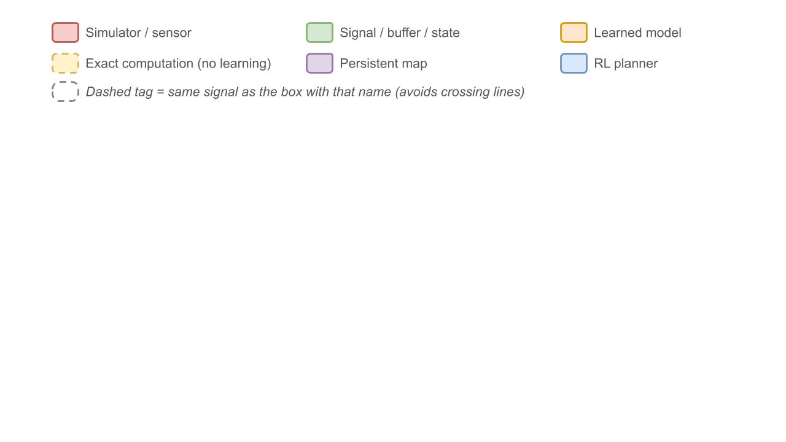
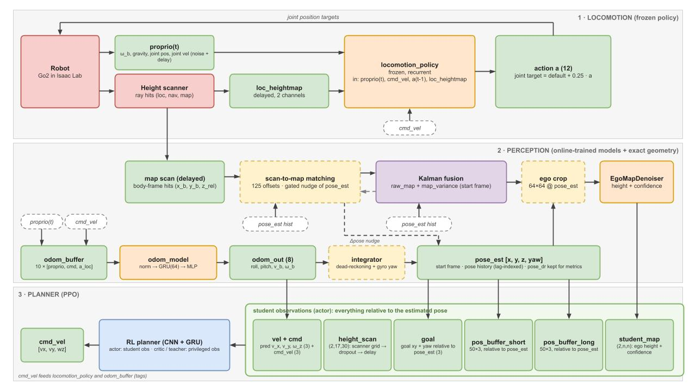
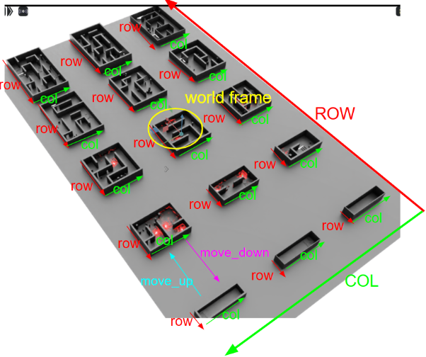
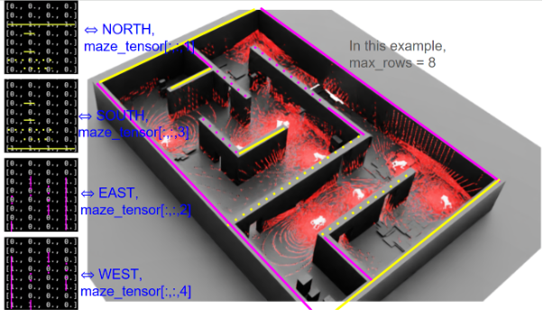
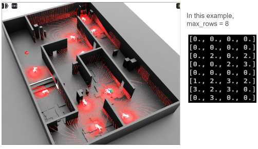
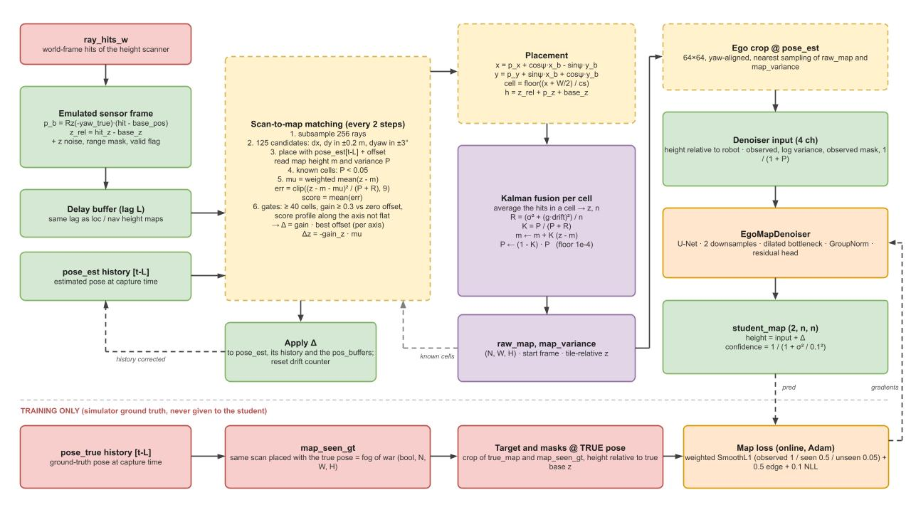
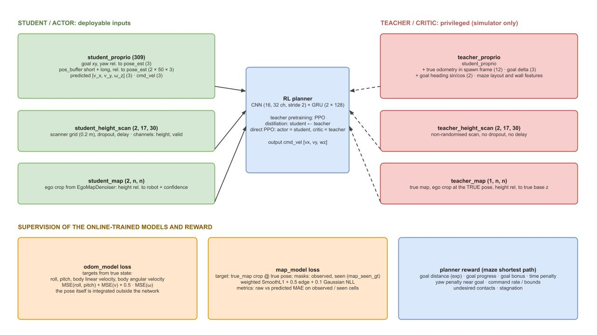

# Go2 Navigation: Documentation

This document explains how the navigation environment works: the data flow of one control step, the frames and maze conventions, the perception stack (odometry, map, scan-to-map correction), the observations given to the planner, and what supervises each learned component.

It is meant to be read next to `README.md` (installation, commands) and `go2_nav_env.py` (implementation). Figures live in `docs/images/`.

> **Path note.** Links below assume this file sits at the repository root. If you move it into `docs/`, change `docs/images/` to `images/`.

## Contents

1. [Diagram legend](#1-diagram-legend)
2. [Pipeline overview](#2-pipeline-overview)
3. [Frames and notation](#3-frames-and-notation)
4. [Terrain and maze conventions](#4-terrain-and-maze-conventions)
5. [Perception](#5-perception)
6. [Observations, privileged information and supervision](#6-observations-privileged-information-and-supervision)
7. [Delays, resets and randomisation](#7-delays-resets-and-randomisation)
8. [Configuration reference](#8-configuration-reference)
9. [Metrics and debugging](#9-metrics-and-debugging)
10. [Moving to a real robot](#10-moving-to-a-real-robot)
11. [Known limitations](#11-known-limitations)

---

## 1. Diagram legend

All pipeline figures use the same colours.



---

## 2. Pipeline overview



The figure has three lanes. One `env.step()` runs them in this order (all in `_pre_physics_step`, then `_get_observations`).

---

## 3. Frames and notation

| Frame | Definition | Used for |
|---|---|---|
| world | Isaac Sim frame | simulator state, rewards, maze tables |
| start frame | robot pose at the start of the episode: origin at the spawn point, x along the spawn heading | persistent map, goal, position histories, pose estimate |
| true pose | ground truth in the start frame (`_true_pose_s`) | supervision, teacher observations, sensor emulation. Never given to the student |
| estimated pose | `pose_est = [x, y, z, yaw]` in the start frame (dead-reckoned odometry plus scan-matching nudges) | map placement, student observations |
| body frame | yaw-aligned frame attached to the robot (x forward, y left) | emulated scan, student goal and histories |
| ego crop | window centred on the robot and rotated by its yaw (dim 1 = forward, dim 2 = left) | denoiser input, planner map |

Heights in the persistent map are **tile-relative**: `z_world - env_origin_z`. Ego crops and the planner map are expressed **relative to the robot base height**, so a flat floor reads about `-0.4`.

`pose_dr` is the same dead-reckoning without any scan-matching correction. It exists only to compute metrics.

---

## 4. Terrain and maze conventions

### 4.1 Terrain grid and curriculum



The terrain is a grid of maze tiles. In the figure:

- **ROW** (red) and **COL** (green) are the two axes of the tile grid. Inside every tile the small red and green arrows show the maze's own row and column directions.
- Maze size grows along the curriculum. The cyan **`move_up`** arrow points toward larger mazes, the magenta **`move_down`** arrow toward the small one-row corridors.

Curriculum rule (from `_reset_idx`): the success rate of each terrain cell is tracked with a running average. An environment moves up when its cell's success rate is above 0.8, and moves down when the robot died and the success rate is below 0.2.

### 4.2 Maze tensor



Each maze is stored as a tensor of shape `[MAX_MAZE_ROWS, MAX_MAZE_COLS, 5]`:

#### Channel 0
Channel `0`: corresponds to the celle tye (one-hot when passed in the teacher network);



#### Channels 1 to 4
Channels `1` to `4`: one wall flag per cell side.

In the figure, with `max_rows = 8`, each wall channel is drawn next to the side of the maze it describes:

| Channel | Side in the figure |
|---|---|
| `maze_tensor[:, :, 1]` | NORTH |
| `maze_tensor[:, :, 2]` | EAST |
| `maze_tensor[:, :, 3]` | SOUTH |
| `maze_tensor[:, :, 4]` | WEST |


A non-zero entry means the cell has a wall on that side. The coloured segments on the maze are the walls that the corresponding tensor marks.

**How the code uses these channels.** The shortest-path tables (`_compute_maze_distance_table`) move between cells in *recorded* (tensor) indices and cross a wall pair at each step:

| Step in tensor indices | Wall channel of current cell | Wall channel of neighbour |
|---|---|---|
| row - 1 | 3 | 1 |
| row + 1 | 1 | 3 |
| col - 1 | 4 | 2 |
| col + 1 | 2 | 4 |

So, in tensor indexing, channel 3 is the wall on the `row - 1` side and channel 1 the wall on the `row + 1` side. This is consistent with the figure once you remember that recorded rows are flipped relative to the original rows (see 4.4).

### 4.4 From world coordinates to maze cells

`_world_to_maze_cells` converts a world position to a recorded cell (`cell_size` is the maze sub-terrain's cell size):

```text
local          = position_xy - env_origin_xy
spawn_row      = maze_rows // 2
spawn_col      = maze_cols // 2
original_row   = spawn_row + round(local_x / cell_size)
original_col   = spawn_col - round(local_y / cell_size)
recorded_row   = maze_rows - 1 - original_row      # clamped to [0, maze_rows - 1]
recorded_col   = original_col                       # clamped to [0, maze_cols - 1]
```

So a larger world `x` means a larger original row, a larger world `y` means a smaller column, and the tensor stores the rows flipped. `_maze_cell_centers_world` is the inverse.

### 4.5 Path distance used by the reward

- `_build_maze_path_tables` runs a BFS from every cell and stores all-pairs hop counts. Tables are padded to `MAX_MAZE_ROWS * MAX_MAZE_COLS` cells (flat index `row * max_cols + col`) and shared between environments with identical layouts.
- `_compute_maze_path_distance` returns metres: `hops * cell_size` minus the progress along the corridor toward the next cell on the shortest path (clamped to one cell). In the same cell as the goal it uses the direct Euclidean distance in metres.
- Starts and goals are sampled uniformly in the maze footprint and snapped to cell centres. Their yaw is uniform in `[-pi, pi]`.

---

## 5. Perception



### 5.1 Odometry

| | |
|---|---|
| Input | 10 frames of `[proprio (30), cmd_vel (3), locomotion action (12)]` = 450 values, normalised by a running mean/variance (`_RunningNorm`) |
| Network | GRU (1 layer, hidden 64), MLP `(128, 128)` with ELU |
| Output (8) | `[roll, pitch, vx_b, vy_b, vz_b, wx_b, wy_b, wz_b]` |
| Loss | `MSE(roll, pitch) + MSE(v_b) + 0.5 * MSE(w_b)` against simulator state |

The pose is **integrated outside the network** (`_dead_reckon`):

- yaw rate comes from the delayed gyro (plus a per-episode random bias when `cfg.randomize`), converted with the predicted roll and pitch;
- position comes from the body velocity rotated into the start frame with `R = Rz(yaw) Ry(pitch) Rx(roll)`;
- the displacement over a step uses the mean of the previous and current estimate (trapezoidal rule).

Absolute position is not observable from proprioception, whereas velocity is. This is why the network predicts motion only.

### 5.2 Map scan (emulated sensor)

`_build_map_scan` converts the scanner's world-frame ray hits into the yaw-aligned body frame:

```text
p_b   = Rz(-yaw_true) * (hit_xy - base_xy)
z_rel = hit_z - base_z
```

Output per ray: `(x_b, y_b, z_rel, valid)`. Hits beyond `map_scan_max_range` are marked invalid, and z noise is added when `cfg.randomize`. The true pose is used here only to emulate what a real scanner reports in its own frame.

The scan then goes through `_map_scan_delay_buffer`, with the same lag as the local and navigation height maps. `pose_est` is stored in a history buffer indexed with that lag, so a delayed scan is placed with the pose of its capture time.

The policy-convention navigation grid (`_build_nav_heightmap`) is a separate product used only for `student_height_scan`.

### 5.3 Scan-to-map matching

Runs every `match_period` steps, before fusion, on a subsample of `match_max_points` rays.

1. Build `5 x 5 x 5 = 125` candidate offsets: `dx, dy` in `±0.2 m`, `dyaw` in `±3°`.
2. Place the scan with `pose_est[t-L] + offset`. For every ray read the map height `m` and variance `P` of the cell it lands in.
3. Keep only **known** cells: `P < match_var_thresh` (0.05).
4. For each candidate:
   - `mu` = weighted mean of `z - m` (removes a constant z drift from the xy search);
   - `err = clip((z - m - mu)^2 / (P + R), 9)`;
   - `score = mean(err)` over known cells. Candidates with fewer than `match_min_points` known cells get the worst score.
5. Accept the best candidate only if:
   - it has at least `match_min_points` known cells;
   - it beats the zero-offset score by `match_improve_thresh`;
   - the score profile along each axis is not flat (see below).
6. Apply `gain * offset` per accepted axis, and `Δz = -gain_z * mu`.

**Observability per axis.** The 125 scores are reshaped to a `5 x 5 x 5` cube. For the x axis the profile is the best score at each of the 5 x offsets (minimum over the other two axes). If `max(profile) - min(profile) < match_axis_obs_thresh` (0.5), moving along x does not change how well the scan fits, so x is not corrected. The same is done for y and yaw.

| Situation | Result |
|---|---|
| Straight corridor along x | x flat (not corrected), y and yaw corrected |
| Empty flat floor | all three flat, nothing corrected |
| Corner or distinct walls | all three corrected |

The correction is applied to `pose_est`, to its history buffer and to the position histories, and the "distance since last correction" counter is reset. Because mazes revisit places, this behaves as loop closure.

### 5.4 Kalman fusion

Each map cell stores a height estimate `m` and a variance `P` (initial `P = 1e6`, "no idea"). All hits landing in a cell in one step are averaged to `z` with count `n`, then:

```text
R = (map_meas_std^2 + (map_drift_var_gain * distance_since_last_correction)^2) / n
K = P / (P + R)
m <- m + K * (z - m)
P <- (1 - K) * P            # floored at map_min_variance
```

- Drift inflation makes scans taken after a long uncorrected stretch less trusted.
- The variance floor keeps `K` above zero so wrong early values can still fade.
- The implementation uses two pre-allocated flat buffers (`_fuse_sum`, `_fuse_cnt`) that are re-zeroed only at touched cells, so the cost depends on the number of points, not on the map size.

### 5.5 Ego crop and denoiser

`_compute_crops` samples a `map_crop_cells x map_crop_cells` window (default 64) with nearest-neighbour sampling, centred on `pose_est` and rotated by its yaw. The training target and masks are sampled at the **true** pose. Near the robot, both windows cover the same physical area even if the estimated frame has drifted.

**Denoiser input, 4 channels:**

| Channel | Content |
|---|---|
| 0 | height relative to the robot (`0` ground prior in unobserved cells) |
| 1 | normalised `log(P)` |
| 2 | observed mask (`P < map_observed_var_thresh`) |
| 3 | `1 / (1 + P)` |

**Output, 2 channels:** height residual and log-variance of the residual. The prediction is `pred_height = input_height + residual`. The planner confidence is `1 / (1 + sigma^2 / map_conf_ref_std^2)`.

**Architecture** (`EgoMapDenoiser`): U-Net with two stride-2 downsamplings, a dilated bottleneck (dilations 2 and 4), GroupNorm, ELU, and a zero-initialised head, so training starts from the identity on the Kalman estimate.

**Loss**, computed every step:

```text
loss = weighted SmoothL1(pred, target)      # observed 1.0, seen-but-unobserved 0.5, never seen 0.05
     + 0.5 * edge loss                       # |grad(pred) - grad(target)|
     + 0.1 * Gaussian NLL(logvar, detached error)
```

The "seen" mask is `map_seen_gt`: the same scan placed with the true pose, a ground-truth fog of war. It is used for supervision only.

---

## 6. Observations, privileged information and supervision



### 6.1 Student / actor (deployable)

| Group | Shape | Content |
|---|---|---|
| `student_proprio` | 309 | goal xy and yaw relative to `pose_est` (3); short and long position buffers relative to `pose_est` (2 x 50 x 3); predicted `[vx_b, vy_b, wz_b]` (3); `cmd_vel` (3) |
| `student_height_scan` | `[2, 17, 30]` | navigation grid (0.2 m): height and valid mask, with dropout and delay |
| `student_map` | `[2, n, n]` | ego crop: predicted height relative to the robot, confidence |

### 6.2 Teacher / critic (simulator only)

| Group | Shape | Content |
|---|---|---|
| `teacher_proprio` | student + extras | `student_proprio`, true odometry in the spawn frame (12), goal displacement in world coordinates (3), goal heading sin/cos (2), maze one-hot types and wall channels |
| `teacher_height_scan` | `[2, 17, 30]` | same grid without randomisation, dropout or delay |
| `teacher_map` | `[1, n, n]` | true map, ego crop at the true pose, relative to the true base height |

### 6.3 Planner training modes

- **Teacher pretraining:** PPO with privileged observations.
- **Distillation:** the student learns from the teacher.
- **Direct PPO:** the actor uses student observations, the critic uses teacher observations.

The planner is a CNN (16 and 32 channels, stride 2, ReLU, global average pooling) followed by a 2-layer GRU of size 128.

### 6.4 Supervision of the online-trained models

| Model | Target | Loss |
|---|---|---|
| `odom_model` | true roll, pitch, body linear and angular velocity | `MSE(roll, pitch) + MSE(v) + 0.5 MSE(w)` |
| `EgoMapDenoiser` | true map crop at the true pose, masks `observed` and `seen` | see 5.5 |

### 6.5 Reward

The planner reward is based on the maze shortest-path distance.

| Term | Purpose |
|---|---|
| `rew_goal_distance` | exponential of the remaining path distance (main shaping term) |
| `rew_goal_progress` | clipped decrease of path distance since the previous step |
| `rew_goal_bonus` | goal position and yaw reached |
| `pen_goal_penalty` | constant time penalty |
| `pen_goal_orientation` | yaw error, only very close to the goal |
| `pen_cmd_rate` | squared change of `cmd_vel` between steps |
| `pen_cmd_bounds` | commands above 1.0, and a translational command `\|[vx, vy]\| <= 0.2` while still far from the goal |
| `pen_undesired_contacts` | base, hip and thigh contacts |
| `pen_stagnation` | no path progress for the stagnation window |

Episodes terminate on goal reached or base contact, and truncate at the time limit.

---

## 7. Delays, resets and randomisation

### 7.1 Delay buffers

With `cfg.delay = True` the environment uses:

| Buffer | Delays |
|---|---|
| `_proprio_delay_buffer` | proprioception (locomotion and odometry paths) |
| `_loc_heightmap_delay_buffer` | local height map for the locomotion policy |
| `_nav_heightmap_delay_buffer` | navigation height map for the planner |
| `_map_scan_delay_buffer` | body-frame map scan |
| pose histories | `pose_est` and the true pose, read with the height lag |

The three height-sensor buffers and the pose histories share one lag (`_height_lag`), because they come from the same sensor. Lags are sampled in `[0, delay_length)`. At reset, only the resetting environments get new lags.

### 7.2 Episode reset

`_reset_idx` resets, for the environments being reset:

- the robot, locomotion hidden state and odometry hidden state;
- `odom_buffer`, odometry output, `pose_est`, `pose_dr`, pose histories, drift counter, position histories, commands, stall counter;
- goals, starts and the true start-frame map;
- the **persistent map** (`raw_map`, `map_variance`, `map_seen_gt`), the student map and the navigation grid;
- delay buffers and lags, gyro bias, and the scan randomisation angles.

Environments that just reset see a blank map observation for their first step, because perception runs at the start of the next control step.

### 7.3 Randomisation

| Item | Controlled by |
|---|---|
| noise on proprioception | `cfg.randomize` |
| scan offset, yaw and roll misalignment of the policy-convention scan | `cfg.max_offset`, `cfg.max_rot` (set `max_rot = 0` to disable) |
| cell dropout on the navigation and local grids | `cfg.n_zeros`, `cfg.sigma`, `cfg.max_reset_zeros_freq` |
| z noise on the map scan | `map_scan_noise` (needs `cfg.randomize`) |
| gyro bias per episode | `gyro_bias_max` (needs `cfg.randomize`) |

---

## 8. Known limitations

- The environment rewrite has not been run in Isaac Lab by its author. Tensor shapes and the `DelayBuffer` and `raycast_mesh` interfaces are untested.
- The yaw correction from scan matching is applied to the current pose, not rotated about the capture-time position. This is a second-order effect for corrections of at most a few degrees.
- The ground-truth `map_seen_gt` marks only the sensor footprint, so the "completion" loss covers holes in the footprint, not areas behind walls. Never-seen cells have a small loss weight.
- The map scan does not apply dropout (the navigation grid does).
- Scan matching cost grows with `match_max_points`, the 125 candidates and the number of environments. Use `match_chunk` and `match_period` to trade accuracy for memory and speed.
- The denoiser targets and the teacher map use nearest-neighbour crops of a map that was itself rotated with bilinear interpolation from the heightfield, so wall edges may be slightly blurred in the target.
- The wall-channel labels in the old debug comments disagree with `maze_conventions.png` (section 4.2).

---

## Repository layout

- `source/go2_nav/go2_nav/tasks/direct/go2_nav/go2_nav_env.py`: simulation loop, pose estimation, scan matching, map fusion, observations, delay buffers, rewards, resets, debug plotting, `EgoMapDenoiser`.
- `source/go2_nav/go2_nav/tasks/direct/go2_nav/go2_nav_env_cfg.py`: robot, terrain, sensors, actions, observations, delay and reward configuration.
- `source/go2_nav/go2_nav/tasks/direct/go2_nav/networks/`: custom CNN and RNN models.
- `source/go2_nav/go2_nav/tasks/direct/go2_nav/agents/`: PPO, teacher and distillation configurations.
- `scripts/rsl_rl/train.py`: training entry point.
- `policies/`: TorchScript locomotion checkpoints.
- `docs/images/`: figures used by this document (`legend.jpg`, `go2_nav_pipeline.jpg`, `scan_map_correction.jpg`, `obs_loss_rew.jpg`, `terrain_conventions.png`, `maze_conventions.png`, `example_maze.png`).
